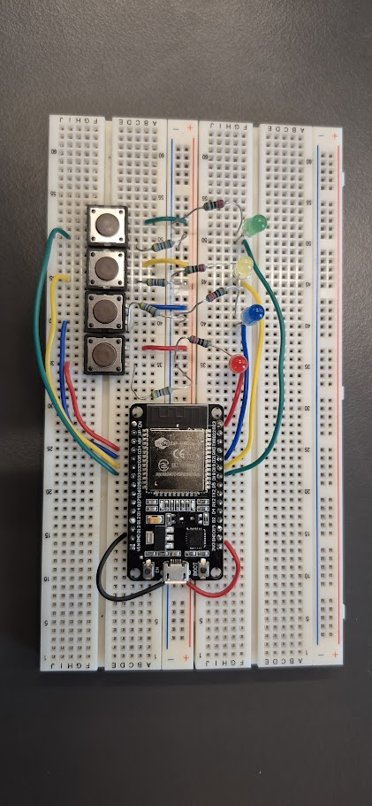

# Log – 24. november 2026

## Formål
Vi startede projektet **Smiley Feedback Panel**: et panel med fire knapper, hvor brugeren kan give feedback ved at trykke på en farve. Hver knap har sin egen LED, der lyser som bekræftelse på trykket.

## Hardware
Vi byggede kredsløbet på et breadboard med:

- 1 × ESP32 DevKit V1 (DOIT)
- 4 × trykknapper
- 4 × LED'er (grøn, gul, blå og rød), hver med en formodstand
- Ledninger til forbindelserne mellem knapper, LED'er og ESP32

### Pinforbindelser

| Farve | Knap (GPIO) | LED (GPIO) |
|-------|-------------|------------|
| Grøn  | 33          | 18         |
| Gul   | 32          | 19         |
| Blå   | 35          | 21         |
| Rød   | 34          | 23         |

## Software
Projektet er lavet i PlatformIO med Arduino-frameworket (`espressif32@8.0.0`) og biblioteket **ezButton** til at læse knapperne.

### 1. Knapper og LED'er
- Hver knap læses med `ezButton` med en debounce-tid på 50 ms.
- Når en knap trykkes, lyser den tilhørende LED i 500 ms.
- Det virkede, og vi lavede commit'et `ButttonsWorking`.

### 2. Deep sleep
Vi gik derefter i gang med at få ESP32'en til at spare strøm med deep sleep:

- ESP32'en vågner via en timer efter 10 sekunder (`esp_sleep_enable_timer_wakeup`).
- Funktionen `writeWakeupCause()` skriver i Serial Monitor, hvad der vækkede chippen (timer, knap eller touch).
- Variablen `startUps` gemmes i RTC-hukommelsen med `RTC_DATA_ATTR`, så den overlever deep sleep og tæller, hvor mange gange chippen er startet op.
- Det arbejde ligger i commit'et `NeedSomeImplementationForDeepSleep`.

## Problemer vi løste

**Upload-fejl: "Wrong boot mode detected (0x13)"**
ESP32'en kom ikke selv i download-mode ved upload. Løsningen var at holde **BOOT**-knappen nede, mens der stod `Connecting...`.

**Compile-fejl: "increment of read-only variable 'startUps'"**
`startUps` var erklæret som `const RTC_DATA_ATTR int`, og en `const`-variabel kan ikke ændres. Vi fjernede `const`, så linjen blev `RTC_DATA_ATTR int startUps = 0;`.

## Status og næste skridt
- Knapperne virker.
- Næste skridt er at få deepsleep til at virke.
